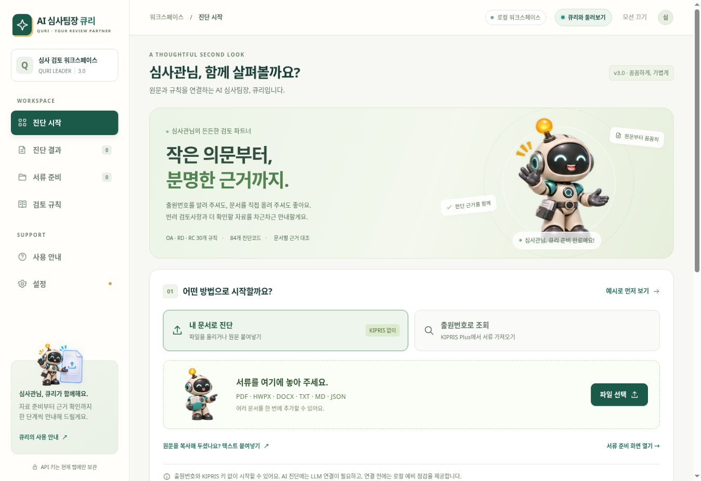
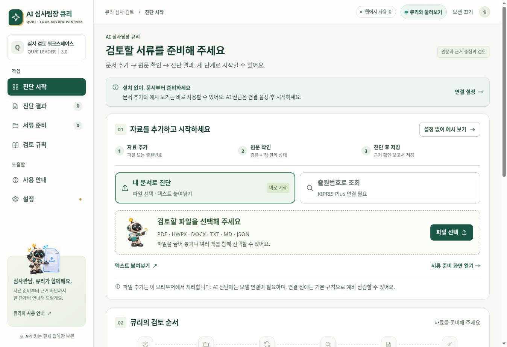
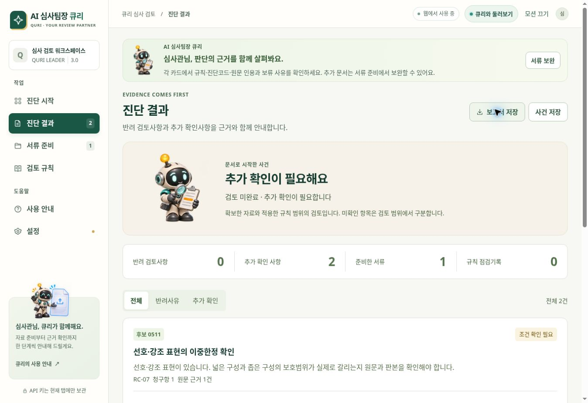

# 공개 사이트 개선·검증 기록

검증일: 2026-11-23 (Asia/Seoul)  
공개 주소: https://aireviewer.moip.ai.kr/  
개선 전 기준: `0a328cbb566aa4f56ef0d2266e972e9c7de4fcc3`

## 반영 내용

- 본문·입력란 16px, 주요 버튼 15px를 중심으로 글씨와 대비를 보강했다. 사용자가 바로 자료를 넣을 수 있도록 시작 영역을 앞에 배치했다.
- 파일 추가 → 원문 확인 → 진단 후 저장의 순서를 표시했다. 예시는 API 설정 없이 볼 수 있으며 합성 자료임을 계속 표시한다.
- 모델 연결 설정을 KIPRIS Plus보다 앞에 배치했다. 필수 모델 입력 직후에도 설정을 적용할 수 있다.
- 공개 웹·파일·로컬 환경을 구분한다. 공개 사이트에서는 로컬 중계 옵션을 비활성화하고, API 계층에서도 요청 전에 차단한다.
- 연결 확인 중 중복 실행과 설정 변경을 막고 취소 신호를 전달한다. 잘못된 모델 목록/JSON 응답을 연결 성공으로 표시하지 않는다.
- 해시 주소, 브라우저 뒤로 가기, 직접 화면 링크를 지원한다. 상속 속성 이름을 화면으로 오인하지 않는다.
- 배포 후 실제 브라우저에서 확인된 구형 스크립트 캐시 문제를 줄이기 위해 CSS·JS 주소에 파일 내용의 해시를 붙인다. CI가 해시 누락과 오래된 체크섬을 검사한다.
- 기존 `main` 브랜치 게시 및 CNAME을 유지한다. 검사 전용 Actions와 `.nojekyll`을 추가했다.

## 자동 검증

| 구분 | 확인 결과 |
| --- | --- |
| 기존 소스 시험 | 194개 중 193개 통과, 실패 0, 선택적 네이티브 시험 1개 건너뜀 |
| 공개 호스팅/API·UI 회귀 추가 후 로컬 전체 시험 | 207개 중 206개 통과, 실패 0, 선택적 시험 1개 건너뜀 |
| 자원 버전 회귀 추가 후 GitHub Actions | 210개 중 209개 통과, 실패 0, 선택적 시험 1개 건너뜀 |
| 필수 입력 직후 설정 적용/연결 상태 후속 수정 | 실제 HTML 계약, 웹 연결 안내, 연결 중단·입력 잠금 관련 3개 집중 시험 통과 |
| 정적 자원·구문 | 로컬 자원 15개, JavaScript 7개 검사 통과 |
| 자원 버전 | 스크립트·스타일시트 10개 내용 해시 검사 통과 |
| 체크섬 | 최종 소스 수정 후 갱신, 재검사 통과 |

전체 210개 시험의 확인된 실행: [Validate public site](https://github.com/EQAI-MOIP/AI_Reviewer/actions/runs/45177100419). 해당 소스의 [Pages 배포](https://github.com/EQAI-MOIP/AI_Reviewer/actions/runs/45177103840)도 성공했다. 이후 커밋의 결과는 [최신 Actions 실행](https://github.com/EQAI-MOIP/AI_Reviewer/actions)에서 확인할 수 있다.

## 실제 공개 브라우저 확인

로컬 Chromium 실행은 환경의 Unix socket 제한으로 불가능했다. 별도의 브라우저에서 실제 HTTPS 공개 주소를 열어 다음 항목을 확인했다. 아래 기록은 DOM 모의시험과 구분되는 공개 사이트 조작 결과다.

| 시나리오 | 관찰 결과 |
| --- | --- |
| 첫 화면 | 웹 사용 상태와 연결 안내 표시. 파일 선택·예시 버튼 접근 가능 |
| 글자와 배치 | 본문 16px, 모델 입력란 16px, 주요 파일 버튼 15px. 확인한 1348×926 데스크톱 화면에서 문서 전체의 가로 넘침 없음 |
| 세 가지 합성 예시 | 반려 검토사항, 적용 범위에서 발견 없음, 추가 확인 필요 상태가 각각 표시됨 |
| 규칙 검색 | `0511` 검색에 RC-07 및 공식 코드 0511 내용 표시 |
| 브라우저 뒤로 가기 | 설정에서 이전 검토 규칙 화면으로 복귀 |
| 공개 연결 설정 | CORS 설명 표시, 로컬 실행 도우미 옵션 비활성화 |
| 파일 추가 | 저장소의 합성 등록청구항 TXT(781바이트)를 선택하여 1개 문서로 추가·추출 |
| API 미설정 예비 점검 | 조건 확인이 필요한 후보 2개 표시, 최종 확정 결과로 표시하지 않음 |
| 사건 저장 | 8,199바이트 JSON 다운로드 완료, 사건 형식 및 원문 포함 확인. `llmKey`, `kiprisKey`, `Authorization` 필드 없음 |
| 보고서 저장 | 3,864바이트 Markdown 다운로드 완료 |
| 오류 로그 | 확인한 공개 사이트 URL에서 발생한 JavaScript 오류·경고 기록 없음. 브라우저 확장 자체 로그는 앱 오류로 집계하지 않음 |

### 화면 기록

개선 전:

개선 후:

합성 문서의 예비 점검:

## 확인 범위의 한계

개인 API 키를 이용한 유료 모델 호출, 실제 KIPRIS Plus 출원 수집, 실제 업무 문서의 판독·진단 정확도 평가는 수행하지 않았다. 공개 사이트의 API 직접 연결 가능 여부는 제공자의 CORS·인증·상품 권한에 달린다.

작은 화면용 CSS를 반영하고 소스를 검토했지만 이 기록의 시각 검증은 위 데스크톱 환경에 한정된다. 모든 모바일 기기·브라우저의 호환성을 시험한 것으로 해석하지 않는다. 기본 CI에서 선택적 네이티브 XML/ZIP 브라우저 시험은 별도 설정이 없어 건너뛴다.
